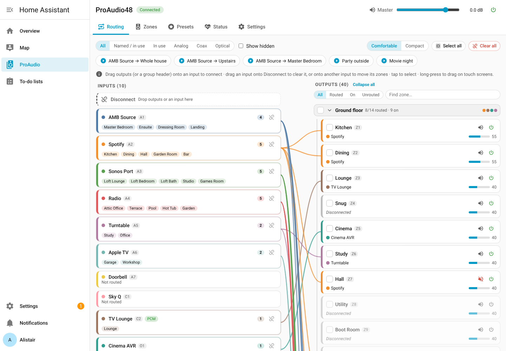
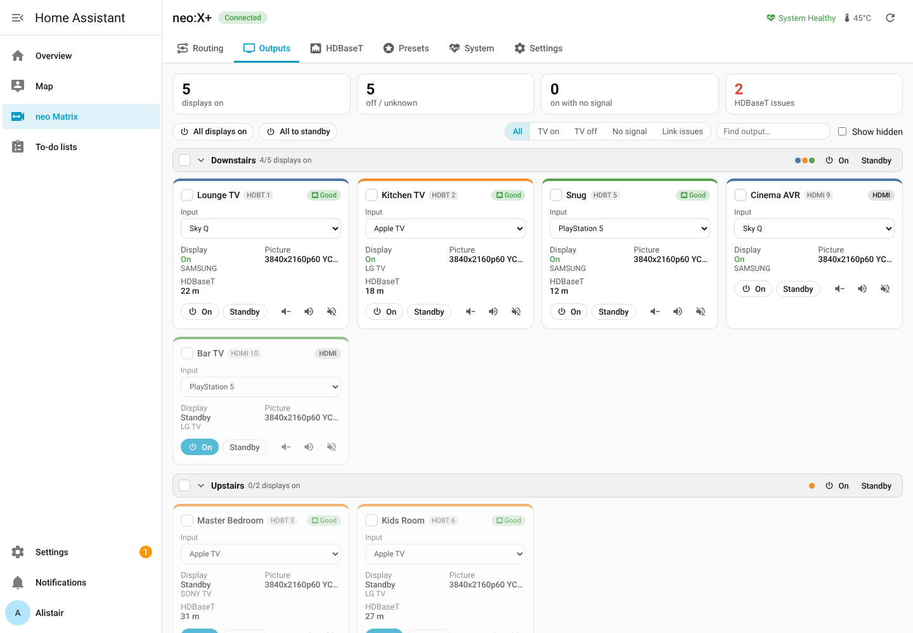
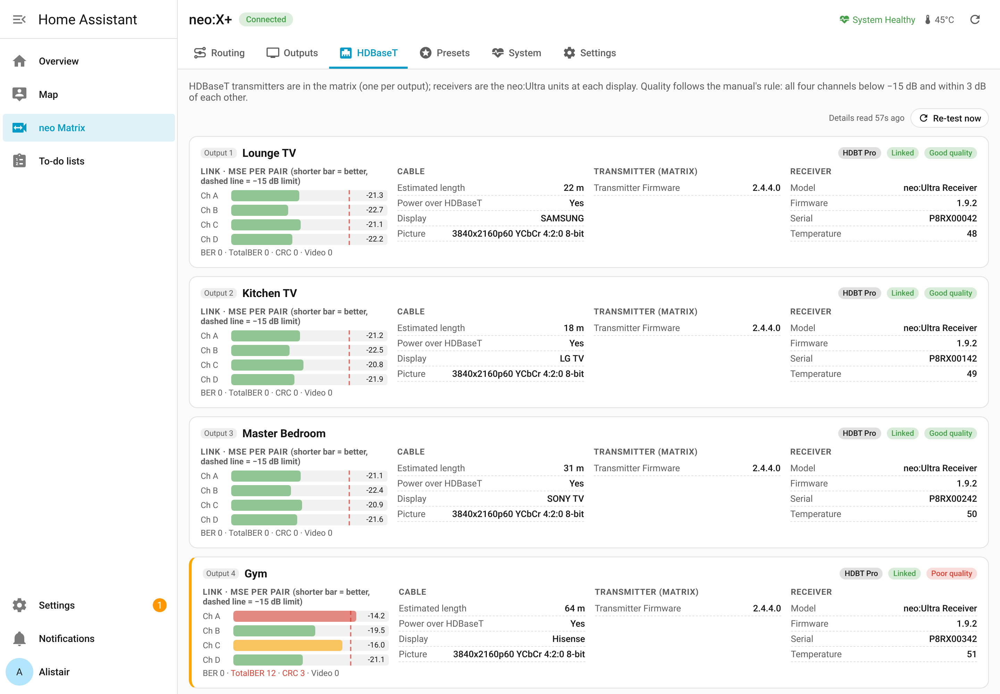
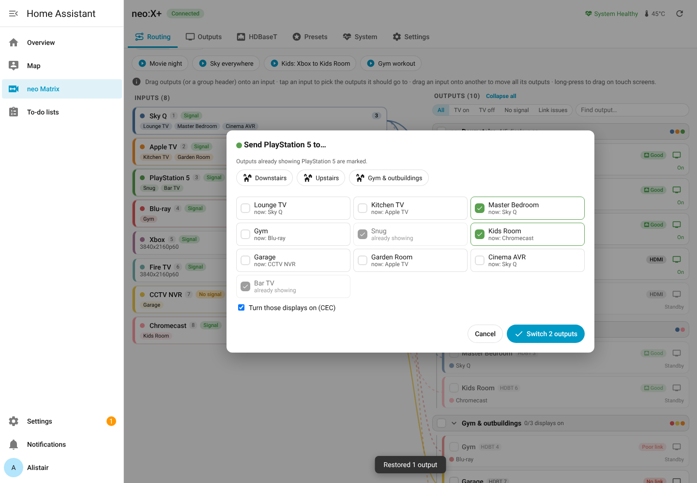

# Pulse-Eight neo Matrix for Home Assistant

A custom integration and control panel for **Pulse-Eight neo video matrices**. It's built for the **neo:X+** (model code FF88SA), and is written to also handle neo:X, neo:XMR, neo:XSR, neo:8/8a, neo:6a and neo:4. It talks to the matrix directly on your LAN over its HTTP/JSON API. No cloud account is needed.

It shares its design with the ProAmp8 and ProAudio integrations, so the three panels look and behave alike.



## The **neo Matrix** sidebar panel

| Tab | What it does |
|---|---|
| **Routing** | Video inputs on the left and outputs on the right, with colour-coded lines showing what's on each screen. The panel works both ways round:<br>• **Drag one or more outputs onto an input**, or drag a whole output-group header.<br>• **Tap an input** to open a "Send … to" sheet, then tick outputs or whole groups. It can also switch those displays on over CEC.<br>• **Drag an input onto another input** to move every output it feeds.<br>Every change has **Undo**. Each input shows its signal state, and each output shows display power (CEC), signal and HDBaseT link health. A selection bar sends CEC on/standby, volume and mute. An **Audio** layer appears in audio sink mode, for independent audio routing including the digital audio inputs 9–12. |
| **Outputs** | The status overview. One card per output shows its current input (with a dropdown to change it), display power, the display model, the picture format, audio (if routed separately) and the HDBaseT cable length. It also has On/Standby and CEC volume/mute buttons, a summary strip (displays on, on with no signal, HDBaseT issues) and filters. |
| **HDBaseT** | One card per HDBaseT output. It shows link status, a Good/Poor quality rating, and Mean Square Error bars for each cable pair with the −15 dB limit marked. It also shows BER/CRC/video errors, estimated cable length, Power over HDBaseT, the transmitter firmware, and **receiver details** (neo:Ultra model, firmware, serial number, temperature). **Re-test now** re-reads everything. |
| **Presets** | One-tap scenes, such as *Movie night*: Blu-ray to Cinema and Lounge, displays on, and every other display to standby. They're also exposed as HA buttons and through the `apply_preset` action. |
| **System** | Model and code, firmware, serial number, MAC, hardware revision and uptime. Health covers the system, power supply and input/output modules. It also shows the five temperature sensors, network settings, CEC and audio modes, an input signal table and recent errors. |
| **Settings** | Input and output **names are read from the matrix**, and edits are **written back to the matrix**, so the matrix web UI, Alexa and other control systems see them too. You can also hide unused ports and arrange outputs into **groups**, both stored in Home Assistant. |

The panel works in the HA phone app (long-press to drag), in light and dark themes, and as a dashboard card (`type: custom:neo-matrix-card`, after adding `/pulse_eight_neo_static/neo-panel.js` as a dashboard resource).

| Outputs overview | HDBaseT | Send to… | Phone |
|---|---|---|---|
|  |  |  |  |

## Entities

- **The matrix device:** system status, with all health fields as attributes, plus model, firmware, serial number, Temperature 1–5, last boot and connectivity. It also has one *Input N … signal* sensor per input, and *Restart*, *Refresh details* and one button per preset. Where the matrix reports them, there are also:
  - power-supply rail sensors (12 V, 5 V, …);
  - *Status LEDs*, *CEC*, *CEC automatic switching*, *CEC auto-pause* and *CEC combination keys* switches;
  - a *Logo backlight* select (off/on/auto);
  - an *Input N EDID* select per video input (Dynamic, 1080p, 4K, 4K 7.1, HDR10 …, or *Copy output N*);
  - an *Input N source remote* per video input (disabled by default) for sending CEC keys to the source device itself.
- **One device per output**, which you can assign to its room's area:
  - A **media player**, whose source is the routed input. On/off sends **HDMI-CEC power** to the display, and its state comes from the display's CEC power report. Volume up/down and mute use the matrix's `CEC/Volume` command (which reaches the TV or AVR, whichever handles audio), falling back to CEC keys on older firmware. Mute is a toggle on the matrix side. Play/pause/stop are sent as CEC keys.
  - Sensors for *video format* and *display connected*.
  - A **Display remote** (`remote.send_command` with key names such as `up`, `select`, `back`, `input_select`, or codes such as `0x44`), and an *IR profile* select (disabled by default).
  - If the matrix restricts which inputs an output may show (`AllowedSources`), only those are offered, and other routes are refused.
  - On HDBaseT outputs only: *HDBaseT linked*, *Link quality* (Good/Poor, with per-pair dB values as attributes) and *Estimated cable length*. The receiver details are attributes of the link sensor.

## Actions

| Action | Example |
|---|---|
| `pulse_eight_neo.route` | `outputs: ["Lounge TV", 9]` or `group: Downstairs`, `input: "Sky Q"`, `power_on: true` |
| `pulse_eight_neo.route_audio` | `outputs: [3]`, `input: 9` (for sink mode with independent audio; `0` disconnects) |
| `pulse_eight_neo.cec_power` | `outputs: [1, 2]`, `on: false` |
| `pulse_eight_neo.cec_key` | `outputs: [1]`, `key: volume_up`. Other keys include `mute`, `input_select`, `play`, `pause` and `select`, or a code such as `0x44`. |
| `pulse_eight_neo.cec_volume` | `outputs: [1]`, `action: up` (`down`, `mute`) |
| `pulse_eight_neo.apply_preset` | `preset: Movie night` |
| `pulse_eight_neo.get_status` | Returns each output's input, display power and signal (for scripts and voice). |
| `pulse_eight_neo.refresh` | Re-reads the HDBaseT, health and port details now. |

## Install

1. Push this folder to its own GitHub repository (HACS allows only one integration per repository). The contents of this folder must sit at the **root** of the GitHub repository (`hacs.json` and `custom_components/` at the top level, not inside a subfolder). HACS installs from GitHub releases: the included *Release* workflow creates one (for example `v1.1.1`) automatically whenever the `version` in `manifest.json` changes on `main`, and you can also run it by hand from the **Actions** tab. Without a release, HACS shows *"'' is not a usable version"*.
2. In HACS, go to **Custom repositories**, add the repository as type **Integration**, install it and restart Home Assistant. *(Or copy `custom_components/pulse_eight_neo` into `<config>/custom_components/`.)*
3. Go to **Settings → Devices & services → Add integration → Pulse-Eight neo Matrix**. Enter the matrix IP address and, if your firmware requires it, the web UI **admin password** (the default is `admin`). If the password later stops working, HA asks for it again.
4. Open **neo Matrix** in the sidebar.

Options let you change the routing/status poll interval (default 5 s) and the detail poll interval for HDBaseT, health and port details (default 60 s).

## Discovery and instant updates

- **Discovery:** Home Assistant offers to add a neo matrix it sees on the network (DHCP hostname `p8sn…`, Pulse-Eight MAC prefix). ProAmp8 and ProAudio units share the MAC prefix and are ignored.
- **Instant updates:** the matrix broadcasts its state (routing, signal, display power, temperatures) on UDP port 8811 whenever something changes. The integration listens for these by default, so changes made on the matrix's own web UI, its IR remote or another control system show up within a second. While pushes are arriving, HTTP polling drops to every 30 s as a safety net; the System tab shows *Live* when pushes are reaching Home Assistant.
  - Broadcasts don't cross VLANs or routers, so Home Assistant needs a network interface on the matrix's subnet. In Docker, use host networking or publish UDP 8811.
  - Packets are only accepted from the matrix's own address (or a sender that identified itself with the matrix's serial). That's identification, not security; see *Security* below.
  - Turn it off under **Configure** if you don't want it.

## How it works

Everything is local HTTP to port 80, and requests are sent one at a time because the matrix's web server is small.

| Purpose | Request |
|---|---|
| Identity, health, features | `GET /System/Details`, `/System/Health`, `/System/Features` |
| Ports (Input / Output / Mirror), type (`HDMI`, `HDMI2`, `HDBT-TXPRO`, `HDBT-TXLITE`), display power (`DPS`) | `GET /Port/List` |
| Routing, when `Port/List` has no `ReceiveFrom` | `GET /Port/List/Concise` → `{"Output1":[0], …}` |
| Monitoring link | `GET /Monitoring/Settings` |
| Status LEDs | `POST /System/StatusLED/{on\|off}` |
| Link status, MSE per pair, cable length, PoH, display, video format | `GET /Port/Details/{Input\|Output}/{bay}` |
| HDBaseT receiver details | `GET /Port/RemoteDetails/Output/{bay}` |
| Route video / audio | `GET /Port/Set/{in}/{out}`, `GET /Audio/Route/{in}/{out}` |
| CEC power / volume / keys | `GET /CEC/{on\|off}/Output/{bay}`, `GET /CEC/Volume/{Up\|Down\|Mute}/Output/{bay}`, `POST /cec/key/Output/{bay}` `{"Code":"0x41"}` |
| Input EDID profile | `GET /Port/EDID/Set/{profile}/{bay}` |
| Backlight / status LEDs | `POST /System/BacklightLED/{off\|on\|auto}`, `POST /System/StatusLED/{On\|Off}` |
| CEC settings | `POST /CEC/Enable\|Disable`, `POST /cec/switching/{on\|off}`, `GET/POST /CEC/AutoPause`, `GET /CEC/ComboKeys[/set/{true\|false}]` |
| IR profiles | `GET /IR/Profiles`, `GET /IR/Details/{bay}`, `POST /IR/SetProfile/{bay}` `{"Profile": n}` |
| State pushes | UDP broadcast to port 8811 (types 0 identity, 2 ports, 21 temperatures) |
| Rename a port | `POST /Port/SetName/{mode}/{bay}` `{"Name": "…"}` |
| Modes | `GET /Audio/SinkMode`, `/Audio/ManualMode`, `/CEC/AutoPowerOn`, `/Network/Settings` |
| Login (if a password is set) | `POST /Account/Login` `{"Password": "…"}` → session cookie |

**Sources:**
- Pulse-Eight's open-source control drivers (github.com/Pulse-Eight/drivers: Control4 *neo_Common* and *neoX+*, Crestron Home, Elan, RTI).
- The protocol notes of **chrisns/pulse-eight-matrix** (MIT), an independent HA integration for these matrices, tested on an FF88 with MatrixOS 3.10.5-1. The UDP packet layout, EDID profile numbers, CEC/IR settings endpoints, `AllowedSources`, the `psu` health list and the capitalised `StatusLED/On|Off` come from there.
- The neo:X+ manual. The link-quality rule is taken from it.

- The official API reference at monitoring.pulse-eight.com/APIDocs (installer login). Checked in v1.1.0: the `Port/List` fields and types, Mirror ports, `Port/List/Concise`, the CEC On/Off/Volume/Key commands and key table, `System/Details` and `Features`, the LED commands and `Monitoring/Settings`.

**Not yet verified on real hardware** (these pages in the official docs are empty or marked "currently unavailable"):
- The exact field names that receiver and transmitter details use on your firmware. Those panes simply show whatever the matrix reports.
- The `Port/SetName`, `Port/SetLinkMode` and `Audio/Route` behaviour on the neo:X+.

**Diagnostics** (on the device page) download the raw API responses with the serial number and MAC redacted. That's the quickest way to map anything that shows up blank.

## Security

The author of *chrisns/pulse-eight-matrix* has published a security advisory for MatrixOS firmware, based on testing a neo:8 (FF88) on MatrixOS 3.10.5-1. It reports:

- unauthenticated control endpoints;
- a memory-corruption bug in the raw-CEC parser;
- unsigned firmware updates fetched over plain HTTP;
- a plaintext cloud channel.

I haven't verified these claims. Their advice is to put the matrix on an isolated VLAN with no internet access, reachable only from Home Assistant and your management machine. This integration only talks to the matrix on your LAN and never contacts Pulse-Eight. It does not send raw CEC frames, only the documented power and key commands.

## Roadmap

1. **CEC.** Done: display power, volume, keys, display and source-device remotes, "turn on when routing" and a power-off option in presets. Next could be a "TV remote" card in the panel.
2. **ProAudio awareness**, aimed at your setup. The plan:
   - Let each neo output, or audio output zone A–J, be linked to a ProAudio input in Settings.
   - Expose neo inputs as sources in the ProAudio panel. Picking "Sky Q" for the Kitchen zone would then route Sky Q to a free linked neo output and that output's ProAudio input to the Kitchen zone in one go.
   - The ProAudio integration already exposes `pulse_eight_proaudio.route` for this, and the matrix's own "Linked Device" setting (for the ProAmp8) can be read to suggest the mapping.

## Development

```bash
pip install pytest-homeassistant-custom-component
pytest                                                 # backend tests against a simulated neo:X+
python tests/fake_neo.py --port 8080 --password admin  # simulator for UI work
```
