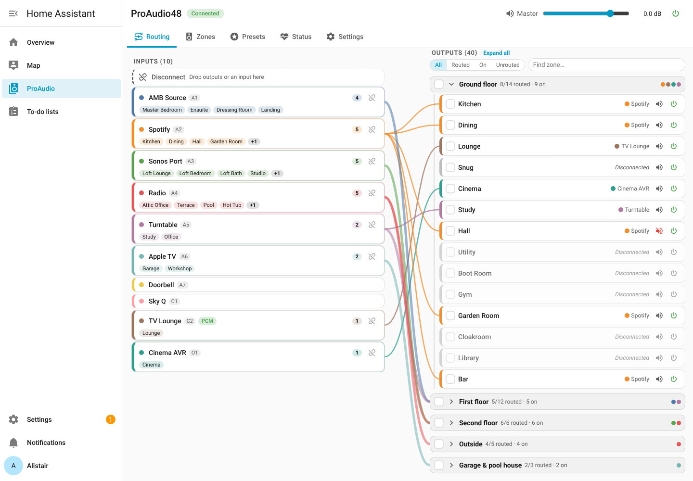
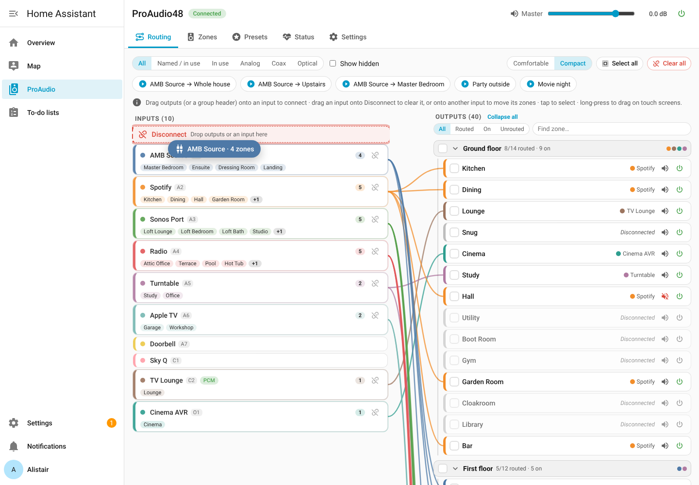
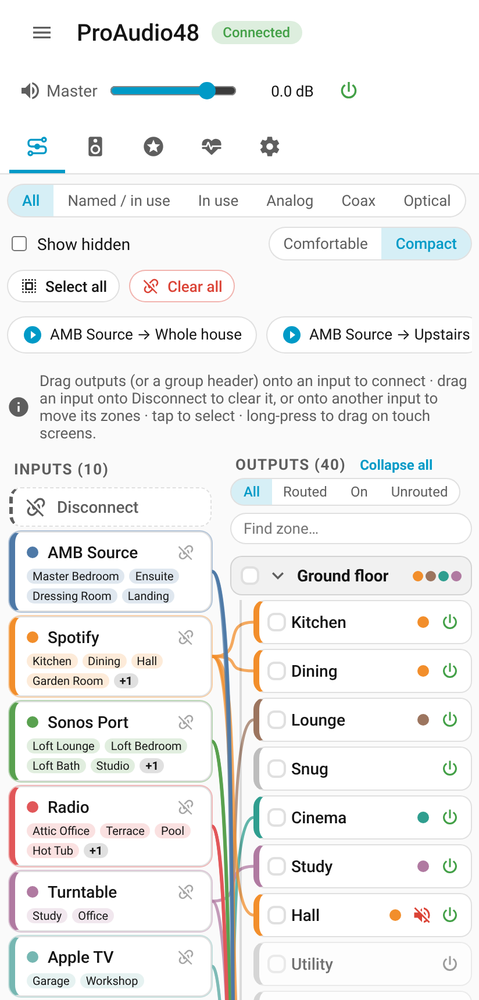

# Pulse-Eight ProAudio for Home Assistant

This is a custom integration and control panel for the **Pulse-Eight (Zektor) ProAudio** DSP audio matrices: ProAudio8, 16, 1632, 32, 48 and 64. It talks to the unit directly over your LAN on raw TCP port 50005. No cloud connection or extra hardware is needed.


## What you get

### ProAudio sidebar panel

| Tab | What it does |
|---|---|
| **Routing** | Inputs on the left, outputs on the right, with colour-coded lines showing where each input goes. To route, drag one or more outputs onto an input, or **drag a whole zone-group header** onto an input. **Drag an input onto Disconnect** to clear every zone it feeds, or use the ✕ on the input card; **drag an input onto another input** to move all its zones across. Every routing change shows an **Undo** toast, Clear all included. The inputs column stays put while you scroll a long output list. |
| **Zones** | One card per zone with a source picker, volume slider, mute and power. Cards are grouped by zone group, with On/Off/Mute buttons for each group and for all zones. |
| **Presets** | One-tap routing scenes such as *AMB Source → Whole house*, *AMB Source → Upstairs* or *AMB Source → Master Bedroom*. Each preset can power the zones on, unmute them and set a volume. It can also be **exclusive**, which disconnects any other zones playing that input (so "Master Bedroom only" really means only there). In the editor you can tick zones, mix inputs, or copy the current routing. |
| **Status** | Connection, model, firmware, serial number, power state, master volume, IP/mask/gateway/DHCP, protocol flags (ASY/ACK/ECO/XIO), and zones on/routed/muted. It shows **signal type on digital inputs** (No signal / PCM / Dolby-DTS) and a log of recent errors with their meanings. |
| **Settings** | Name every input and output, hide the ones you don't use, and arrange zones into **groups** (e.g. Ground floor, First floor, Outside). Names are used throughout Home Assistant. |

**Long zone lists (40+ outputs):**
- **Zone groups** collapse into one header, which shows how many zones are routed and on and the colours of the inputs feeding them. A collapsed group still gets routing lines.
- The **Compact** density puts each zone on a single line, roughly 40 zones per screen. It's the default on phones.
- **Output filters:** All, Routed, On or Unrouted.
- **Find zone** search matches zone names and input names.
- Collapsed groups and the density setting are remembered in each browser.

The panel has a master volume slider and a unit power button in the header. It updates live: changes made from the front panel, the unit's web page or another controller show up instantly. It works on desktop and in the HA phone app; on touch screens, **long-press an output to drag it**.

The same view is also available as a dashboard card:

```yaml
type: custom:proaudio-card
tab: routing        # routing | zones | presets | status | settings
# entry_id: ...     # only needed if you have more than one ProAudio
```

To use the card, first add `/pulse_eight_proaudio_static/proaudio-panel.js` as a JavaScript module under **Settings → Dashboards → ⋮ → Resources**.

| Compact, groups collapsed | Clear an input (drag onto Disconnect) | Dark | Phone |
|---|---|---|---|
|  |  |  |  |

### Entities

- **One media player per zone.** Each zone is a separate device (e.g. "Kitchen"), so you can put it in an area. It supports source select, volume, mute and on/off, so it works with the standard media cards, voice and automations.
- **Master volume** (number, in dB: −100 = mute, 0 = unity, up to +24).
- **Unit power** (switch).
- **Buttons:** *Clear all routing*, *Re-sync*, and **one button per preset**. Preset buttons are added and removed automatically as you edit presets.
- **Sensors:** model, firmware, serial, IP address, zones on, zones routed, last error, and a connectivity sensor.

### Actions (for automations and scripts)

| Action | Example |
|---|---|
| `pulse_eight_proaudio.route` | `zones: [1, 3, 5]` and/or `group: "Upstairs"`, `source: "Spotify"` (an input name or a source number; `0` disconnects) |
| `pulse_eight_proaudio.apply_preset` | `preset: "AMB Source → Whole house"` |
| `pulse_eight_proaudio.clear_all` | |
| `pulse_eight_proaudio.zone_power` / `zone_mute` / `zone_volume` | `zones: [2]` or `group: "Outside"`, `on: true` / `mute: true` / `volume: 35` |
| `pulse_eight_proaudio.send_command` | `command: "BAZ @1,140"` returns `{error_code: 0}`. Factory reset and IP changes are blocked. |

## Installation

1. Push this folder to its own GitHub repository (HACS allows only one integration per repository). The contents of this folder must sit at the **root** of the GitHub repository (`hacs.json` and `custom_components/` at the top level, not inside a subfolder). HACS installs from GitHub releases: the included *Release* workflow creates one (for example `v1.1.1`) automatically whenever the `version` in `manifest.json` changes on `main`, and you can also run it by hand from the **Actions** tab. Without a release, HACS shows *"'' is not a usable version"*.
2. In HACS, go to **⋮ → Custom repositories**, add the repo URL as type **Integration**, install it and restart Home Assistant.
   *Or copy `custom_components/pulse_eight_proaudio` into `<config>/custom_components/` and restart.*
3. Go to **Settings → Devices & services → Add integration → Pulse-Eight ProAudio**. Enter the unit's IP address; the port is 50005.
4. Open **ProAudio** in the sidebar. Start on the **Settings** tab to name your inputs and zones and hide the unused ones, then create your presets.

## How it talks to the unit

The integration follows the *ProAudio Universal Serial Protocol* (v1.1) and Pulse-Eight's open-source Control4 drivers.

- It keeps one persistent TCP connection and parses every `^=…$` frame, including the breakaway form `^=SZ.2 @001,003$` that the Control4 driver enables. With **ASY** on (the factory default), changes are pushed instantly. A full re-sync also runs every 30 s; you can change this under Configure.
- It works whether **ACK** is on or off. When another controller has turned ACKs off, errors (`^!n$`) are still detected and shown in the panel.
- **It never changes the unit's XS settings or saves anything to EEPROM**, so it can safely share the unit with Control4 or other controllers.
- Source numbers depend on the model and on **XIO** mode. Both are detected automatically. On a ProAudio32, sources are analog 1–32, coax 33–64 and optical 65–80.
- **Commands used:**
  - `V?`, `P`, `MV` and `XS?` for the unit;
  - `SZ` for routing;
  - `PZ` for zone power;
  - `VPZ` for volume as a percentage of each zone's min/max range;
  - `VMZ` for mute;
  - `MZ?` and `ATZ?` for status;
  - `IPAX?`, `IPMX?`, `IPGX?` and `IPSET?` for network details.

**Mute** uses `VMZ` (volume mute), as the protocol guide recommends. `MZ` is a hard disconnect and is only shown, not used for muting. **Clear all** sets every zone to source 0 (`SZ @1:N,0`).

Routing applies to the **analog** zone outputs. By default the coax outputs mirror them, so they follow automatically.

## Development

```bash
pip install pytest-homeassistant-custom-component
pytest                                          # backend tests, using a fake unit over real TCP
python tests/fake_proaudio.py --port 50005      # simulator for UI work
```

`tests/fake_proaudio.py` is a protocol-accurate simulator. It supports ACK on/off, the breakaway suffix, async push to all clients, error codes and standby.
